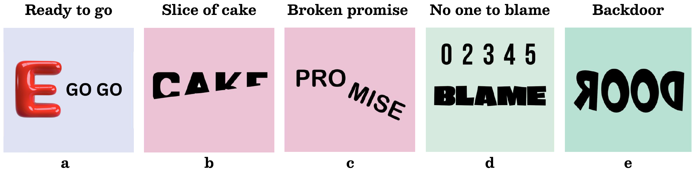

# RebusBench for Evaluating Cognitive Visual Reasoning

[](https://arxiv.org/abs/2604.01764)



RebusBench contains **1,164 English rebus puzzles** for evaluating visual-language models on visual wordplay and reasoning. Each puzzle represents a word or phrase through visual arrangement, repetition, color, position, or size of text and symbols.

[Dataset on Hugging Face](https://huggingface.co/datasets/amirkasaei/rebusbench) | [Project website](https://amirkasaei.github.io/rebusbench/) | [Paper](https://openreview.net/forum?id=LCc2CP4aS4)

## Load the dataset

```bash
pip install -U datasets Pillow
```

```python
from datasets import load_dataset

dataset = load_dataset(
    "amirkasaei/rebusbench",
    revision="v1.5",
    split="test",
)

print(len(dataset))  # 1164
sample = dataset[0]
image = sample["image"]  # PIL image
print(sample["puzzle_id"], sample["answers"])
```

The complete collection is packaged as one `test` split. No training or validation split is provided; this split name does not establish exclusion from any model's training data.

| Field | Description |
| --- | --- |
| `image` | Puzzle image, decoded as a PIL image |
| `puzzle_id` | Unique integer from 1 through 1164 |
| `answers` | Nonempty list of normalized English reference answers |

The local images and `data/metadata.jsonl` match the Hugging Face v1.5 dataset. Each metadata record contains `file_name` (relative to `data/`), `puzzle_id`, and `answers`.

## Reference answers and evaluation

There are **1,198 references** across 1,164 puzzles: 1,131 puzzles have one reference, and 33 have multiple references. Slash-separated alternatives from the original workbook are stored as separate list entries. For example, puzzle 50 has `answers = ["farm animal", "animal farm"]`.

Normalization applies Unicode NFKC normalization, Unicode case folding, and whitespace collapsing. Punctuation, accents, spelling, and word order are not otherwise changed. Reference order is retained and does not indicate a preferred answer.

Apply the same normalization to predictions. Exact match accepts any supplied reference; token F1 should take the highest score across references for each puzzle before averaging.

```python
import unicodedata

def normalize(text):
    return " ".join(unicodedata.normalize("NFKC", text).casefold().split())

def exact_match(prediction, answers):
    return normalize(prediction) in answers

assert exact_match(" ANIMAL   FARM ", ["farm animal", "animal farm"])
```

References may not cover every valid phrasing. Interpretation can depend on English idioms and visual conventions. The alternatives are retained from the original annotations and have not been independently revalidated.

## Repository layout

```text
README.md
data/
   metadata.jsonl              Image filenames, puzzle IDs, and reference answers
   puzzle_1.png ... puzzle_1164.png
examples/
   example_evaluation.ipynb     Original sample evaluation code
   requirements.txt            Suggested sample dependencies
docs/
   index.html                  GitHub Pages website
   static/                     Website CSS, JavaScript, images, and animations
```

## Sample evaluation notebook

`examples/example_evaluation.ipynb` is optional sample code for evaluating LLaVA, InternVL, Qwen2.5-VL, and Qwen3-VL. Its contents are unchanged. It is separate from dataset loading and is not a fully validated reproduction package.

```bash
git clone https://github.com/amirkasaei/rebusbench.git
cd rebusbench
pip install -r examples/requirements.txt
jupyter notebook examples/example_evaluation.ipynb
```

Adapt its original data paths, Excel-based label loading, model paths, and inference settings before running. The spreadsheet has been replaced by `data/metadata.jsonl`, which was checked against all original workbook records. The sample's original label loader does not consume the new metadata or handle reference alternatives automatically. Its generated outputs go to `agg_results/`. The dependency list is a starting point, not a verified lockfile.

## Project website

GitHub Pages uses `docs/`. The website and all existing assets are preserved at their original paths.

## Data provenance and license

The JSONL metadata was derived from the original answer workbook by splitting alternatives on `/` and applying the documented normalization. All 1,164 records and 1,198 references were checked against the workbook before removing the redundant spreadsheet. Puzzle images are unchanged. Detailed collection and annotation procedures and a dataset license have not yet been documented in this repository.

## Citation

```bibtex
@inproceedings{kasaei2026rebusbench,
    title={Hidden Meanings in Plain Sight: RebusBench for Evaluating Cognitive Visual Reasoning},
    author={Seyed Amir Kasaei and Arash Marioriyad and Mahbod Khaleti and MohammadAmin Fazli and Mahdieh Soleymani Baghshah and Mohammad Hossein Rohban},
    booktitle={ICLR 2026 Workshop - From Human Cognition to AI Reasoning: Models, Methods, and Applications},
    year={2026},
    url={https://openreview.net/forum?id=LCc2CP4aS4}
}
```
